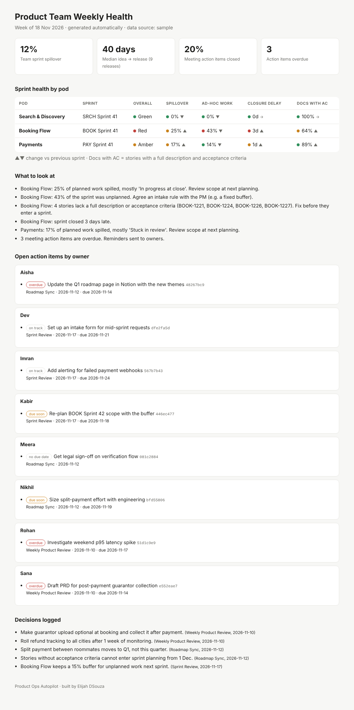

# Product Ops Autopilot

A small automation that does two recurring Product Ops jobs every week, without anyone compiling them by hand:

1. **Sprint health report.** It pulls sprint data from Jira, scores each pod on spillover, unplanned (ad-hoc) work, late sprint closure and requirement quality, compares it with the previous sprint, and writes a plain-language "what to look at" list.
2. **Meeting action-item tracker.** It reads meeting notes, extracts decisions and action items with owners and due dates (using Claude), keeps a running tracker, and sends each owner a Slack nudge for anything overdue, due soon or missing a due date.

It runs on a schedule (every Monday 09:30 IST via GitHub Actions), posts a summary to Slack, and saves a full HTML report.



> The repository ships with **fictional sample data** (pods, people, tickets and meetings are all invented), so you can run the whole thing without access to any real Jira, Slack or notes.

---

## Why I built it

Status updates, sprint health checks and chasing action items are the work that quietly eats a PM or PMO's week. In my PMO role I run sprint cadences and Agile ceremonies across US and India teams, and I wanted the weekly "how are the pods doing and what's slipping" picture to build itself, so the meeting time goes on decisions instead of collecting numbers.

## What it measures

| Metric | Definition | Green / Red |
|---|---|---|
| Spillover rate | Planned issues not Done when the sprint closed ÷ planned issues | < 15% / ≥ 30% |
| Ad-hoc work | Issues added after sprint start ÷ all sprint issues | < 15% / ≥ 25% |
| Closure delay | Days between planned sprint end and actual close | < 1 day / ≥ 3 days |
| Docs with AC | Stories with a 40+ word description that includes acceptance criteria | ≥ 80% / < 60% |
| Idea → release | Median days from idea logged to release | trend only |
| Action-item closure | Tracked action items marked done ÷ all tracked | trend only |

For each pod it also gives a first-pass reason for spillover (not started, stuck in review, in progress at close, thin requirements, carried over again), so the sprint review starts from data.

## Quick start (sample data, no accounts needed)

```bash
python -m autopilot weekly --today 2026-11-18 --dry-run
```

Output:
- `output/weekly_report.html` – the full report (open in a browser)
- `output/weekly_report.md` – the same report in Markdown (paste into Notion or Confluence)
- `output/metrics.json` – raw numbers
- Slack summary and per-owner reminders printed to the terminal (`--dry-run`)

Other commands:

```bash
python -m autopilot actions --today 2026-11-18   # just the action-item chase list
python -m autopilot close <id>                   # mark an action item done
python tools/generate_sample_data.py             # regenerate the sample sprint data
python -m pytest tests                           # run the tests
```

Python 3.10+ and the standard library only; no packages to install (pytest is only for the tests).

## Connecting real tools

Set environment variables (or GitHub Actions secrets):

| Variable | What it does |
|---|---|
| `JIRA_BASE_URL`, `JIRA_EMAIL`, `JIRA_API_TOKEN` | Jira Cloud access (API token from id.atlassian.com) |
| `JIRA_BOARDS` | Pods and their board ids, e.g. `Search:12,Booking:15` |
| `JIRA_SPRINT_FIELD`, `JIRA_POINTS_FIELD` | Custom field ids if yours differ from the defaults |
| `ANTHROPIC_API_KEY` | Uses Claude to extract decisions and action items from free-form notes |
| `SLACK_WEBHOOK_URL` | Posts the summary and reminders to Slack |

Then run `python -m autopilot weekly --source jira`.

Without `ANTHROPIC_API_KEY`, notes are parsed with simple rules: lines starting `Decision:` and `Action: Owner - task - due YYYY-MM-DD`. With the key, Claude handles messy, unstructured notes.

## How it's built

```
autopilot/
  sources.py   sample data loader + Jira Cloud Agile API client (standard library only)
  metrics.py   sprint health metrics, RAG thresholds, cycle time
  actions.py   notes → decisions and action items (Claude or rules), tracker, chase list
  report.py    Markdown, HTML and Slack message rendering
  notify.py    Slack incoming-webhook sender (dry-run by default without a webhook)
.github/workflows/weekly.yml   runs every Monday and keeps the report as an artifact
```

Built with Claude Code.

## Known limits

- In Jira mode, "added after sprint start" is approximated from the issue's created date or an `unplanned` label; reading the sprint-change history would be more exact.
- The tracker is a JSON file. A team version would live in a Notion database or a Jira filter so people can close items where they already work.
- The Jira connector has been written against the documented Agile REST API but tested here only with the sample data.

## Ideas for next steps

- Q&A bot over product docs ("How does X work?", "What's the status of Y?") with links to sources.
- New-hire onboarding checklist that auto-provisions access requests and tracks first-week tasks.
- Track "hours saved" by logging each run against the time the manual version took.
